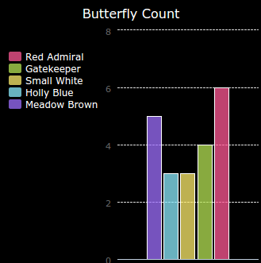

## Challenge: Create a new chart from a file

> [!CHALLENGE]
> Can you create a new bar chart or pie chart from data in a file?
>
> You will need to create a new `.txt` file.

> [!TIP]
> If you want to have spaces in the labels, use `line.split(': ')` and add colons to your data file, e.g. `Red Admiral: 6`.

## Now run your code

Your new chart should display the data from the file you created.

