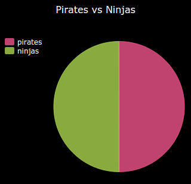

## Challenge: More charts

> [!CHALLENGE]
> Can you create a pie chart and a bar chart from the same file?
>
> You can either use the data you collected earlier or collect some new data.

## Now run your code

Your charts should both display the data from the file you used.

